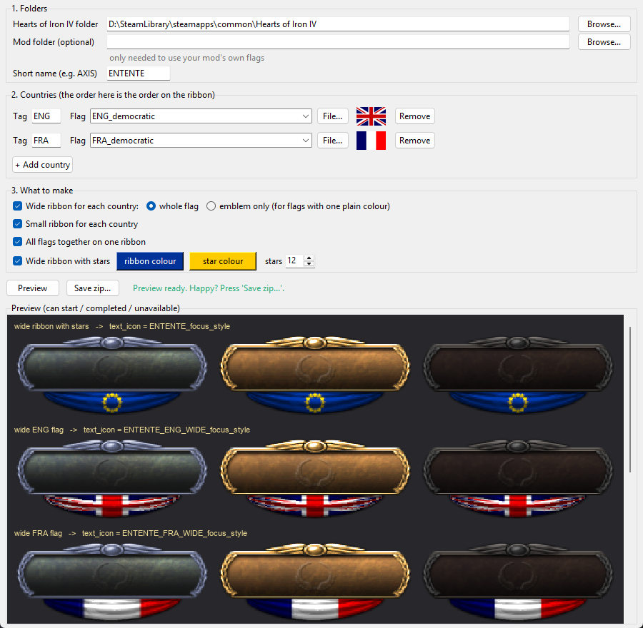
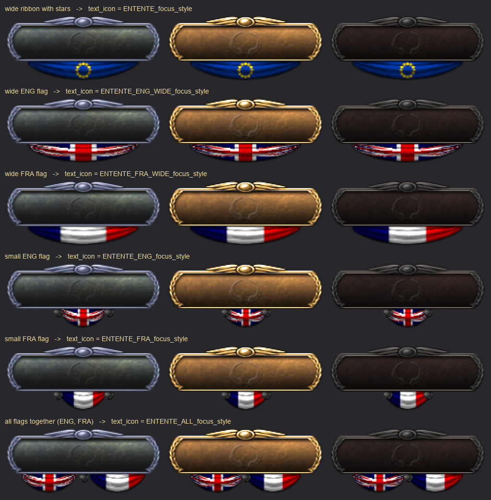

# HoI4 Joint Title Bar Maker

Make the flag ribbons that hang under joint focus title bars in Hearts of Iron IV (the ones you set with `text_icon = ...`), in the same style as vanilla's.



It takes vanilla's own joint title bars from your game install and re-dyes the ribbon with whatever flags you pick, so the folds, shading and frame all stay vanilla. No game files are included here, so you need HoI4 installed.

## What it can make

- a wide ribbon per country (whole flag, or just the emblem)
- a small ribbon per country
- all your flags side by side on one ribbon, with rivets between them like vanilla's Belgium–Congo bar
- a wide ribbon with a ring of stars in your own colours

Every style is made in all three focus states (can start, completed, unavailable).



## Download

Grab the `.exe` from [Releases](../../releases). No Python needed.

Windows will probably say "Windows protected your PC" since the exe isn't signed. Click **More info**, then **Run anyway**. If you'd rather not trust an exe, run it from source (below).

## How to use

1. Your HoI4 folder is found automatically if it's on Steam. The mod folder is optional, you only need it to use your mod's own flags.
2. Give the set a short name, like `AXIS`.
3. Add your countries. Type a tag and the flag list narrows to that country's flags, or press **File...** to use your own image.
4. Tick what you want, press **Preview**, then **Save zip...**.

The zip has everything in mod folder layout, plus a big preview and a `HOW_TO_USE.txt`:

```
gfx/interface/focusview/titlebar/                the textures (.dds)
interface/<name>_titlebars.gfx                    sprites
common/national_focus/<name>_titlebar_styles.txt  styles
```

Unzip it into your mod, then put the line you want on a joint focus:

```
text_icon = AXIS_GER_focus_style
```

Restart the game afterwards, new sprites don't load from a save reload.

## Run from source

Needs Python 3.9+ and Pillow.

```
pip install pillow
python titlebar_maker.pyw
```

Or just double-click `Start.bat`, it installs Pillow on first run.

There's also a command line version:

```
python joint_titlebars.py --game "C:/.../Hearts of Iron IV" --mod out --prefix AXIS ^
    --shared stars --nation GER=GER_fascism ITA=ITA_fascism --group BOTH=GER,ITA --preview preview.png
```

Run `python joint_titlebars.py -h` for all options.

## Building the exe

```
py -3.13 build_exe.py
```

## License

MIT
